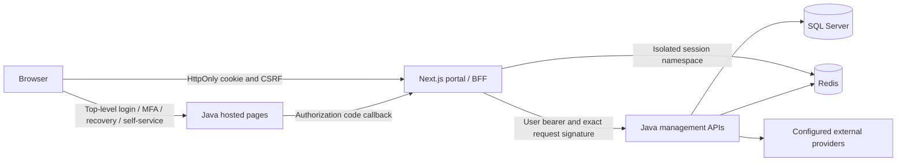

# Identity account portal and administration console

Date: 18 October 2026. Status: **design and execution plans approved in chat 2026-10-21**.
Original draft/review history is retained below; backend implementation contracts are now published in [API-CONTRACT.md](../../portal/API-CONTRACT.md).
Repository baseline: `2f90ecd5720bfbf3fa20e87d6e61f1e9a0c23b82`.
Companion review: [repository findings](2026-10-18-identity-portal-review.md).

## Intent and scope

Provide an enterprise interface for this identity service: an account portal for users and an administration console for clients, users, organizations, roles/permissions and certificates. The user requested all five management areas, a professional enterprise design, and a specification/plan before code changes. Next.js was recommended and the review/spec/planning stage approved. The concrete stack, session policy and delegation decisions below were subsequently approved in chat on2026-10-21.

Success means a person can register and configure a usable client, manage authorized identities and organizations, and verify the result through genuine browser/API/database flows. A polished screen backed by a mock response does not count. The product must show understandable failures when infrastructure or providers are unavailable.

Included: account landing/profile display, navigation to existing hosted authentication and self-service, organization context, client onboarding/settings/credentials/resources, user lifecycle and role assignment, role definitions, certificate lifecycle and operational error states. Resource catalog editing is platform-only because clients depend on it.

Excluded from this project: business workflows such as orders/payments, arbitrary OAuth scopes/grants, device authorization, real-provider emulation in production, Touch ID/WebAuthn, bulk import, billing, public signup/invitations/email delivery, and replacing the existing Java login/MFA/recovery engine. Audit UI is a follow-up milestone after an actor-attributed backend audit exists; it is not silently included in the first release.

## Architecture and stack decision

Proposed choice: `web/` Next.js App Router, strict TypeScript, Node 24 LTS, React version supported by the selected patched Next release, MUI community components with the official Next SSR adapter, React Hook Form + Zod, Vitest and Playwright. npm lockfile, exact dependency versions selected and reviewed at implementation; no canary releases or paid UI licenses. Java 25, SQL Server, Redis and existing migration history remain authoritative. No new ORM or frontend SQL connection.

Alternatives considered: React/Vite is simpler static hosting but leaves token handling in the browser unless another session service is built; a separate Java-rendered admin UI minimizes services but has a larger interactive-table/forms implementation burden. Choose Next.js for the server-side browser session boundary, accepting a separately deployed Node service.

The BFF has no privileged machine token for user administration. Every management operation carries that human's token; Java evaluates permissions, membership and target scope. BFF route checks improve UX and defense in depth but cannot replace Java enforcement.

## Global constraints

- Application code, dependencies, database state and running services stay unchanged until the user approves this design and execution plan.
- Existing database records, hashing/signing keys, clients and demo accounts must be preserved; only additive new migrations, never edits to V1–V11 or schema resets.
- OAuth access/refresh/ID tokens, signing material and client secrets must not be stored in browser localStorage/sessionStorage or emitted in URLs, HTML, client props, analytics, logs or screenshots; authorization-code and standard logout parameters are transient protocol exceptions and must be redacted.
- Java is the authorization authority; all human management API calls require a user bearer token and server-side tenant checks.
- Production sessions require HTTPS, HttpOnly, SameSite=Lax and Secure cookies; loopback HTTP development may disable Secure explicitly.
- Existing login, MFA, recovery and profile/password form CSRF and proof checks remain enforced; no global security toggle is weakened to integrate the portal.
- New lists use page size 25, allowed sizes 10/25/50/100, query length at most 100; existing legacy user search accepts at most 50 until the backend is deliberately expanded.
- New portal errors use `{code,message,fieldErrors?,requestId,retryable}`; secrets and upstream stack traces are never returned.
- Local simulated-provider success and real-provider success must be reported separately.

## Identity, authorization and organization policy

Platform administrator is identified by the existing `idp-admin-org:switch` claim and may select any organization. Organization administrators operate only in their own organization. Developers operate on authorized clients and credential certificates. Viewers read authorized metadata. Account users have self-service only. Permission checks use explicit keys; having a group alone never grants administration. Existing machine URL permissions remain a separately tested integration path and cannot be used by the human portal as an escape hatch.

Proposed initial delegation rules:

| Actor | Organizations | Clients / credentials | Users | Roles | Certificates |
|---|---|---|---|---|---|
| Platform admin | Create/read/update/revoke all | Full | Full within selected org | Create/update/deactivate custom roles; assign | Full |
| Org admin | Read/update own contacts/details; no status change | Existing allowed CRUD | Create/update/deactivate local users and assign eligible roles in own org | Read; assign only eligible roles; no role-definition mutation initially | Existing allowed credential-certificate actions; organization private-key import remains platform-only |
| Developer | Read own | Existing allowed CRUD; metadata-only credential reads | None | Read permitted groups | Existing allowed public-key certificate actions |
| Viewer | Read own | Read metadata | None | Read if granted | Read authorized public certificate metadata/download |
| Account user | No admin access | None | Self profile/password via hosted forms | None | None |

Add explicit `idp-admin-user:create/update/delete`, `idp-admin-group:create/update/delete/assign`, and `idp-admin-permission:read` catalog entries. Preserve existing keys; seed only deliberate built-in grants. Role-definition mutations and permission catalog are platform-only in this release, even if a forged claim contains a new action. Organization admin assignment requires group membership in the same org, a permission subset of the actor's effective actions, and exclusion of platform-reserved actions (`idp-admin-org:create/list/switch/deactivate`, role-definition writes, permission catalog, resource catalog writes/assignment, organization-certificate writes). Custom roles cannot contain platform-reserved actions; platform authority stays in the protected built-in platform group in the platform organization. Platform group membership is never assignable by tenant actors. Ordinary user CRUD uses explicit user keys; administrator targets additionally require `idp-admin-admin` actions and the same delegation ceiling.

Expose one active role assignment per user per organization in this release, matching the existing single-group public contract. A user can have no role. Existing multi-role or multi-organization ambiguity must be detected and reported before mutation; never silently discard memberships. New writes serialize on the target user. Built-in role definitions are read-only; custom roles have unique case-insensitive names within the organization and may be deactivated only when unassigned. Assignment and role changes must never remove the last active platform administrator; enforce transactionally under concurrent requests. Self privilege elevation is forbidden. Platform deactivation is blocked for the platform organization. Organization status change requires the platform deactivate permission, independently of editing contacts/name.

Java introspection currently reloads permission claims. Permission removals must affect the next protected API request, including BFF requests from other tabs. `/api/v1/portal/context` is refreshed on page navigation and after changes; never cache permissions as durable authorization.

## Browser session and integration contract

1. GET `/auth/login` creates cryptographically random state, nonce and PKCE S256 verifier, stored server-side for five minutes, bound to a browser transaction cookie. One-use callback; two tabs use independent transaction IDs. Return targets are relative, allowlisted portal paths.
2. Redirect to Java discovery-authorized issuer with `branding=idp`, `openid profile email metadata idp-admin` and the existing required timestamp. No browser credentials collected by Next.js. A user without admin claims still gets the account portal, with no management access.
3. GET `/auth/callback` validates state, exchanges the code using the portal's registered WEB/PKCE client, validates ID-token signature/issuer/audience/nonce/expiry against bounded cached JWKS, stores tokens only server-side and redirects to a clean URL. No refresh token is assumed for the existing public client; token expiry returns the user to sign-in, preserving only a safe navigation target.
4. Opaque random portal session ID in a cookie; Redis prefix `portal:v1:` distinct from Java and provider lab. Session idle timeout 30 minutes, absolute timeout eight hours, always capped by access-token expiry. Rotate session ID after login; delete old record. At idle/token expiry, Java outage or invalid bearer, fail closed; distinguish reauthentication from transient 503. Redis outage produces a controlled 503.
5. POST `/auth/logout` validates Origin and CSRF, invalidates portal session first, then navigates through Java's supported OIDC logout so SSO is ended. A short-lived one-use logout transaction provides a server-controlled redirect; no ID token is returned as JSON. Local signout still succeeds if Java is down, with clear warning that identity-provider SSO logout could not be completed.
6. Browser-facing mutation routes accept only JSON or controlled multipart with Origin and session-bound synchronizer CSRF token; GET never mutates management state. BFF routes are fixed allowlisted functions, not arbitrary URL forwarding. Timeout 10 seconds; no automatic retry of writes or token exchange. Reads may be retried once only for transient transport/503 failures.
7. Capture browser User-Agent/Accept-Language and configured external origin; timestamp is generated in UTC consistently for authorize and later calls. Preserve the same fingerprint context on upstream requests. Treat this as compatibility, not a substitute for authentication. Prove enabled fingerprint/referer checks in the first vertical slice. If incompatible, stop and revise the design rather than disabling enforcement.
8. API adapter adds `x-request-id`, fresh `x-request-datetime`, user bearer and exact-byte Base64 HMAC-SHA256. Do not reserialize signed bodies. Multipart certificate exception follows the existing API rule. `CustomTokenResponseSuccessHandler` exposes `signing_key` as a byte-array token extension (normally Base64 JSON); decode and retain it strictly on the server. API `x-signature` responses use that same token key and cover raw response bytes. Token endpoint body signatures are different: they use an organization certificate, not the ID-token JWKS key. If `AUTH_TOKEN_RESPONSE_CERT_PEM` is configured, require and validate that signature against the pinned public certificate (RSA SHA256 or EC SHA256/P1363 as applicable); otherwise token response transport relies on HTTPS and ID-token verification, with no claim of certificate-body-signature qualification. Never derive the HMAC key from the bearer string.
9. User-specific pages and BFF responses are private/no-store; prevent cross-user server fetch/cache reuse. Tokens and secrets are omitted from SSR props, RSC payloads, browser network JSON and error monitors. Secret creation responses are the single explicit browser display exception: show once in memory in an acknowledgement dialog, then erase on dismissal/navigation.

## Routes and screens

| Portal route | Screen / behavior |
|---|---|
| `/` | Redirect by session to `/account` or show sign-in entry |
| `/account` | Current identity; links to hosted profile/password changes and recovery; no raw token display |
| `/account/security` | Explain password/MFA state exposed by supported contracts; hosted change/recovery links; no unsupported factor enrollment switch |
| `/admin` | Selected organization summary from actual lists; no invented activity metrics |
| `/admin/organizations` | Platform list/create, details and contacts; tenant redirected to own organization |
| `/admin/organizations/[orgId]` | Details/contacts/status with scope-aware actions |
| `/admin/organizations/[orgId]/clients` | Client list/search and create wizard |
| `/admin/organizations/[orgId]/clients/[clientId]` | Overview, URLs, token settings, credentials and resources tabs; `clientId` route is application GUID, OAuth client ID is a separate displayed field |
| `/admin/organizations/[orgId]/users` | Server-paged search/status/type list; create local user |
| `/admin/organizations/[orgId]/users/[userId]` | Profile/email/username/security/status/metadata and eligible role assignment; member GUID is distinct from login GUID |
| `/admin/organizations/[orgId]/roles` | Existing and custom role definitions, permission matrix, member count, platform-only editing |
| `/admin/organizations/[orgId]/certificates` | Certificate type/status/UTC expiry/fingerprint; import/detail/public download/deactivate |
| `/admin/resources` | Platform resource catalog; assignments live under the client |
| `/forbidden`, `/unavailable` | Clear denied/outage states with request ID and safe retry/sign-in action |

Hosted Java pages remain on the identity-server origin and use top-level navigation; do not iframe them or proxy login pages. Profile/password navigation carries existing safe `surl`/metadata/date continuation, preserving SSO and existing HMAC/CSRF handling. Only an allowlisted portal return URL is generated. Hosted pages keep their current branding initially; reskinning them is not required for portal acceptance.

Visual direction: light workspace, dark slate navigation, blue primary action, neutral borders, restrained status colors, 8px spacing scale, 14px table text/16px body, self-hosted system-font fallback, no gradients or decorative charts. Desktop 240px sidebar and clear organization switcher; mobile collapses navigation and preserves critical table columns. Every screen has loading, empty, validation, denied, unavailable and success states. Dialogs trap focus and restore it; forms have labels and field-linked errors; status is never conveyed by color alone. Target WCAG 2.2 AA, keyboard access, 200% zoom and reduced motion. Final visual treatment is subject to user review before full screen rollout.

## Management behavior

**Clients.** Wizard: identity/type/auth method → application and exact redirect/logout URLs → token settings → credentials if confidential → resources → readiness summary. Only WEB/MOBILE+PKCE or supported confidential methods, SERVER+confidential methods; reject SERVER+PKCE in both API and UI. Grants are displayed as derived, not arbitrary checkboxes; scopes show the supported set. Type/auth method immutable after creation. Explicit partial-progress page after any failed step; refetch before retrying uncertain creation and never auto-create a duplicate. No claim of atomicity across legacy API calls. Ready means readback confirms required configuration; issuance is verified using a disposable end-to-end fixture, not by collecting a customer's credentials. Deactivation is confirmed by name and shows that existing tokens are rejected. The existing client list returns active clients only; after deactivation remove the row, show confirmation and do not offer unsupported reactivation. Detail responses gain an additive `active` boolean for readback. Token lifetime units are seconds; API bounds are authoritative.

**Secrets and certificates.** Creation reveals a shared secret once; later reads return metadata only. Maximum two active credentials, rotation creates a second credential, tests it out of band, disables old, then permits deletion. Never log/download a private key from the admin UI. Certificate imports select ORGANIZATION vs PUBLIC_KEY explicitly, use the backend-supported PEM format and a 1 MiB portal upload limit (also enforced server-side); passwords stay in request memory. Public certificate downloads retain server filename sanitization. Validate content, expiry and type on the server; show UTC and local expiry. Warn before deactivating an in-use certificate and show affected credentials if a new dependency-query contract is provided; otherwise require explicit warning without claiming a dependency count.

**Users.** Create only local users through the supported DTO, Base64 password encoding only as legacy transport convention over TLS, never described as encryption. No invitation or delivery success implied. Profile/username/email changes use the matching API and brand; externally synchronized users show their integration mode and stop with an actionable provider-unavailable error when necessary. Admin password reset requires explicit permission/confirmation, does not expose existing passwords, and follows backend password/history policy. Disable/delete maps to backend lifecycle semantics with confirmation; do not promise permanent erasure. MFA setting edits only under the existing security-settings permission; production enrollment/delivery must exist before enabling MFA and is not synthesized. Role assignment changes refresh effective access immediately.

**Organizations and roles.** UI organization ID is context, not authority. Foreign URL IDs are rejected by Java even when browser controls are tampered with. Org revoke confirmation explains client/token impact; no platform-org revoke. Role permission matrix uses a server allowlist, never arbitrary typed claim keys. Existing built-ins cannot be renamed/deleted/rewritten. Custom role update uses an integer revision; stale update returns 409 and requires reload. Deactivate assigned role returns 409 with member count. No role deletion removes users.

**Resource catalog.** Platform creates/updates the existing method/URI/resource schema, then assigns to clients via existing endpoints. Do not call these arbitrary OAuth scopes. Deletion is not offered because there is no reviewed catalog-delete API.

## Required backend contracts

Use existing v1 routes where compatible; credential metadata moves to a new v2 route so removing secret fields is explicit. The portal uses v2 exclusively. Legacy credential GET must also stop revealing secrets before release, with a documented breaking security change; a versioned facade alone does not close R01.

| Contract | Proposed response / rule |
|---|---|
| GET `/api/v1/portal/context` | `{subject:{userId,loginId,username,organizationId},organizations:[{id,name}],permissions:string[],capabilities:{roleWrite,userWrite,resourceWrite,providerMode}}`; permissions for current human, accessible orgs only; providerMode `unconfigured|simulated|external` reflects configuration, not certification |
| GET `/api/v1/portal/permissions` | Platform-only catalog `[{key,description,platformOnly}]` |
| GET `/api/v2/organizations/{org}/applications/{app}/credentials` | `[{id,name,type,algorithm,status,expirationDate,isExpired}]`, no `value`, secret or key material |
| Existing user detail/list extension | Add `organizationId`, `groupId`, `syncMode` fields, retaining existing IDs; derive from authorized SQL mapping, not editable request metadata |
| Existing application summary/detail extension | Add `active:boolean`; retain existing DTO fields and active-only list semantics |
| POST org `/groups` | `{name,description,permissionKeys}` → 201 `{id,name,description,status,permissionKeys,revision,memberCount,readOnly}` |
| PUT org `/groups/{group}` | `{name,description,permissionKeys,revision}` → same role record; stale 409 |
| DELETE org `/groups/{group}` | Soft deactivate only custom unassigned role; 204 or 409 |
| GET org `/groups/{group}` | Role record including revision/memberCount/readOnly; preserve existing group list/permission reads |
| PUT `/api/v1/organizations/{org}/users/{user}/group` | `{groupId:UUID|null}` → 204; transactionally replace same-org assignment, apply delegation ceiling and last-admin guard |

New role name length 1–100 trimmed characters, description ≤1024, no duplicate permission keys, keys must exist in catalog. Scope checks happen before returning target details. New role API errors: 400 validation, 401 no bearer, 403 denied, 404 absent/foreign target, 409 duplicate/stale/assigned/last-admin, 503 dependency outage. Legacy adapters normalize other existing status/body shapes.

New roles/groups revision and membership guarantees use additive migrations V12+ in implementation order. No claims of concurrency protection until SQL integration tests pass. Before upgrading existing data, preflight detects ambiguous memberships and duplicated role names; incompatible data is reported, not automatically rewritten. Existing API clients affected by tightened tenancy or secret removal receive migration notes.

## Delivery sequence and acceptance

1. **Backend foundation:** reproduce review findings, fix secrets/tenant/actor policies, add context and role/assignment APIs and regressions; no UI depends on unimplemented contracts.
2. **Portal first slice:** sign-in → BFF session → context → permission-filtered organization/client read → logout, with enabled fingerprint/signature checks. User approves visual shell before expanding screens.
3. **Client operations:** actual create/configure/credential/resource/deactivate lifecycle, one-time secret display and operational failures.
4. **Organization/user/role/certificate operations:** full permitted workflows, delegation and negative cross-tenant checks.
5. **Release qualification:** real Chrome, Firefox and WebKit flows, keyboard/accessibility checks, fresh and upgrade database migrations, outages and sanitized evidence. Genuine provider checks remain a separately labeled external prerequisite.

Acceptance must include two organizations and platform/org-admin/developer/viewer/account-user principals. Test direct Java calls as well as browser/BFF calls, foreign IDs and crafted bodies, removed permissions without re-login, expired/used state, missing/incorrect CSRF/Origin, two-tab login, idle/token expiry, role-update races and last-admin races, same-day certificate/credential expiry, invalid PEM, conflicting names, duplicate submits/uncertain timeouts, Java/Redis downtime and secret absence from all normal read/render/cache/log paths. Destructive tests own their disposable fixtures and never restart shared Docker.

Every visible mutation has a real HTTP + SQL readback test and at least one permission-denial test. Client creation additionally proves actual PKCE or confidential token issuance; cert/key workflows verify signatures with the advertised key and reject revoked credentials. Report synthetic provider tests separately. Do not claim “everything works” from route counts or a mocked frontend suite.

## Approval decisions

Chat approval on2026-10-21 authorized implementation of these concrete choices: Next.js server/BFF plus MUI, existing Java-hosted auth/self-service, the permission/delegation matrix, single active role per org membership with ambiguity checks, platform-only role-definition editing initially, and audit UI as a later extension. No production domain/hosting choice is required to review this design; use configurable portal/issuer origins and Docker support.

Plans: [backend foundation](../plans/2026-10-18-identity-portal-backend.md) and [frontend and acceptance](../plans/2026-10-18-identity-portal-frontend.md). Both execution plans were approved with this specification on2026-10-21.

## Draft review record

A fresh Superpowers builder-check reviewer read this specification and source context and reported “nothing important left.” Its source check confirmed the existing token `signing_key` extension; that answer is incorporated above. The author checked the two plans against the scope: authorization/context B1–B3/F1, roles B4–B5/F5, client lifecycle B6/F3, users/organizations B1/B3/F4, certificates B6/F6, accessibility/deployment/outages F2/F7. This is a documentation review, not validation of future implementation.

## B7 contract finalization

Role detail and legacy group list now expose authoritative `readOnly:boolean` using the server mutation-protection predicate, including protected legacy grants. This describes definition protection, not designated platform assignment eligibility. Frontend401 actor invalidation requires sign-in plus operator correction of bad SQL relationships; target409 requires review/refetch. Client `active` and credential UTC/null semantics are defined in the implemented API contract. The frontend adapter must strip inherited numeric resource IDs from browser DTOs and use the public catalog GUID for assignment deletion; legacy assignment `id` is a different GUID.
